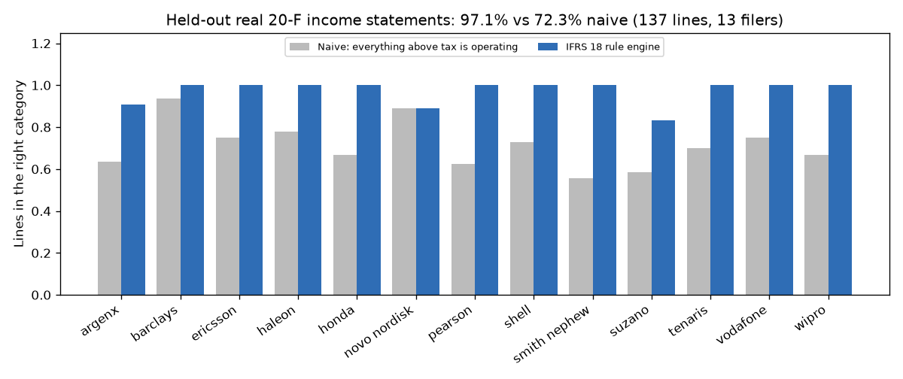

# IFRS 18 Restatement Engine

Restates an IFRS income statement into the five new IFRS 18 categories, with 2026 comparatives, a proof that net income is unchanged, and an Excel workbook with live formulas for reporting and FP&A analysts preparing 2027 accounts.

## Results

- **97.1% of held-out lines classified correctly** (133 of 137 lines from 13 real SEC 20-F income statements), against 72.3% for the naive "everything above tax is operating" restatement.
- **All 4 held-out misclassifications were sent to review** with alternatives and a reason, while only 13.1% of lines were flagged.
- **Net income never changed** under any classification: Hypothesis property tests over 1,300 generated random and adversarial cases, plus all 18 real filers.
- **Excel workbooks matched Python within 1e-9 after a headless LibreOffice recalculation** for all 18 real filers, including a cent-exact adjusted-EBITDA reconciliation with separate tax and NCI lines.



**Stack:** Python, pandas, openpyxl (Excel), LibreOffice headless (recalculation), PyYAML, Hypothesis, pytest, matplotlib, SEC EDGAR Financial Statement Data Sets (XBRL, ifrs-full taxonomy)

## Quickstart

```bash
pip install -r requirements.txt            # LibreOffice is also needed: sudo apt-get install libreoffice-calc
python3 -m ifrs18 restate examples/sample_pl.csv --entity-type general -o restated.xlsx
python3 -m ifrs18 verify-workbook restated.xlsx --tolerance 1e-9
```

The second command prints the suggested categories, the lines flagged for review, the new subtotals for both years and the adjusted-EBITDA reconciliation, and writes `restated.xlsx`. The third opens the workbook in headless LibreOffice, recalculates every formula and compares each subtotal and reconciliation cell with the Python result.

## Why

IFRS 18 *Presentation and Disclosure in Financial Statements* replaces IAS 1 for periods starting on or after 1 January 2027, and the 2026 comparatives must be restated ([XBRL International: IASB launches transformative IFRS 18 standard](https://www.xbrl.org/news/iasb-launches-transformative-ifrs-18-standard/)). Every income and expense line has to be sorted into operating, investing, financing, income taxes or discontinued operations. Two new subtotals become mandatory (operating profit; profit before financing and income taxes). Each management-defined performance measure (MPM), such as adjusted EBITDA, has to be reconciled to the closest IFRS subtotal in the notes, with the tax and non-controlling-interest (NCI) effect of every adjustment shown.

Most teams are doing this by hand in spreadsheets. The mistakes cluster in a few places: interest income, foreign-exchange differences, equity-accounted results, derivatives, and entities whose main business is investing or lending, where the categories flip. A restatement only regroups lines, so if net income moves, something is wrong. That is easy to miss in a hand-built spreadsheet.

## Using it on your own P&L

Export last year's income statement to CSV:

```csv
line_id,label,tag,kind,FY2026,FY2025
L001,Revenue,,item,1250000.00,1180000.00
L002,Cost of sales,,item,-742500.40,-701230.15
S_GP,Gross profit,,subtotal,507499.60,478769.85
...
S_PL,Profit for the year,,profit,158712.97,164623.40
S_NCI,Attributable to non-controlling interests,,attribution,12697.04,13169.87
```

- Amounts are signed so that the lines add up to profit: income positive, expenses negative. Parentheses and thousands separators are accepted.
- `kind` is `item` (a component of profit), `subtotal` (a presented total, ignored when restating), `profit` or `attribution`. It defaults to `item`.
- `tag` is optional. When it holds an XBRL element (for example `ifrs-full:FinanceIncome`), rules match on it before falling back to the label.
- The first period column is the current year and the second is the comparative.

Then run:

```bash
python3 -m ifrs18 restate my_pl.csv --entity-type general -o restated.xlsx \
    --mpm my_adjusted_ebitda.yaml          # optional; <input>.mpm.yaml is picked up automatically
python3 -m ifrs18 restate my_pl.csv --mapping reviewed.csv -o restated.xlsx   # line_id,category overrides after review
python3 -m ifrs18 restate --sec-adsh 0001160106-25-000005 --sec-quarter 2025q1 --entity-type financing -o lloyds.xlsx
python3 -m ifrs18 rules                     # list the rule table
```

`--entity-type investing` (main business is investing in assets, such as insurers or investment entities) and `--entity-type financing` (main business is lending to customers, such as banks) switch interest, dividends and fair-value returns into operating, as IFRS 18 requires. Equity-accounted results stay in investing either way.

### The workbook

| Sheet | Content |
|---|---|
| Original | The statement as reported. |
| Mapping | One row per line: category (a drop-down; the reviewer's input), the rule that fired, the IFRS 18 paragraph, a REVIEW flag (highlighted), the alternatives and the reason. |
| Restated | The IFRS 18 layout: lines grouped by category, category totals via `SUMIF` on the Mapping sheet, the five subtotals, and the difference from reported profit, which must be zero. Changing a category on Mapping recalculates everything. |
| MPM | The MPM reconciliation: IFRS subtotal, each adjustment with its tax effect and NCI effect, and the MPM total. Every amount is `ROUND(…,2)`. |
| Checks | Conservation proofs as formulas: category totals minus original lines, restated profit minus reported profit, and lines without a valid category. All must be 0. |

### Worked example: adjusted EBITDA

`examples/sample_pl.mpm.yaml` defines adjusted EBITDA as operating profit plus depreciation and amortisation (from the notes), goodwill impairment (line L006) and restructuring costs (line L007). The tax rate and NCI share are set per adjustment:

| FY2026 | Amount | Tax effect | NCI effect |
|---|---:|---:|---:|
| Operating profit (IFRS 18 subtotal) | 227,118.85 | | |
| Depreciation and amortisation | 85,400.00 | (21,350.00) | (5,124.00) |
| Impairment of goodwill | 18,000.00 | 0.00 | (1,440.00) |
| Restructuring costs | 12,500.00 | (3,125.00) | (750.00) |
| **Adjusted EBITDA** | **343,018.85** | **(24,475.00)** | **(7,314.00)** |

The synthetic sample's previously reported "operating profit" was 243,919.10. It included the associate and the FX on receivables, and excluded finance items. Under IFRS 18 the associate moves to investing, so operating profit becomes 227,118.85. FX on USD borrowings, lease interest, pension interest and unwinding move to financing; interest income, dividends and investment-property fair-value changes move to investing. Profit for the year stays at 158,712.97.

## How it works

1. **Load** (`ifrs18/statement.py`, `ifrs18/sec.py`). The CSV reader keeps line order. The SEC loader reads `sub/pre/num/tag.txt` straight from a quarterly Financial Statement Data Sets zip. It takes the filing's income statement (`stmt = IS`) in presentation order and the two annual periods. It re-signs each fact using the element's debit/credit balance so that expenses are negative. Presented totals are detected (known total elements, or lines equal to the sum of the lines above them) so that nothing is counted twice. It then checks that the components add up to reported profit.
2. **Classify** (`ifrs18/rules.yaml`, `ifrs18/rules.py`). An ordered table of 18 rules matches XBRL elements and label patterns; the first match wins. Each rule names its category per entity type and the IFRS 18 paragraph it implements. Rules for genuinely ambiguous lines (FX without a stated source, derivatives, netted "other financial results", aggregated finance income, hyperinflation monetary gains, bank interest expense) set a review flag with the alternatives and the reason instead of guessing silently.
3. **Restate** (`ifrs18/restate.py`). Uses exact `Decimal` arithmetic to compute category totals and the IFRS 18 subtotals for both years, plus conservation checks (category totals = sum of lines = reported profit).
4. **Reconcile MPMs** (`ifrs18/mpm.py`). An MPM is an IFRS subtotal plus a list of adjustments, given as amounts from the notes or as add-backs of P&L lines. Tax effect = −amount × rate and NCI effect = −(amount + tax) × share, each rounded half-up to the cent, the same as Excel's `ROUND`.
5. **Write and verify** (`ifrs18/workbook.py`). openpyxl writes formulas, not values, and stores the Python results for every subtotal, check and reconciliation cell in a hidden `_expected` sheet. `verify-workbook` converts the file with `soffice --headless` (using a private profile under `$TMPDIR`), reloads the recalculated values and compares them cell by cell.

## Full results

From `python3 scripts/evaluate.py` (writes `docs/results.md` and `docs/accuracy.png`):

| Split | Statements | Lines | Rule accuracy | Naive baseline | Non-operating lines correct | Flagged for review | Errors caught by a flag | Accuracy on unflagged lines | Net income conserved |
|---|---|---|---|---|---|---|---|---|---|
| dev | 5 | 58 | 100.0% (58/58) | 77.6% | 23/23 | 8.6% (5) | 0/0 | 100.0% | 5/5 |
| heldout | 13 | 137 | 97.1% (133/137) | 72.3% | 50/53 | 13.1% (18) | 4/4 | 100.0% | 13/13 |

Held-out errors (all flagged, all marked ambiguous on the face of the statement in the labels):

| Filer | Line | Labelled | Predicted |
|---|---|---|---|
| Novo Nordisk | Financial income (mostly hedge gains on forecast sales) | operating | investing |
| argenx | Exchange (losses)/gains (mostly on EUR cash) | investing | operating |
| Suzano | Derivative financial instruments (mostly debt swaps) | financing | operating |
| Suzano | Monetary and exchange variations (mostly on USD debt) | financing | operating |

**Corpus.** `corpus/manifest.csv` lists 18 IFRS filers whose 20-F income statements were taken from the SEC Financial Statement Data Sets for 2025 Q1 and Q2 (fiscal 2024 with 2023 comparatives, or fiscal 2025 with 2024). Five are for development (Ferrari, Lloyds, Nokia, National Grid, GSK) and 13 are held out, including two banks (Lloyds, Barclays) classified as financing entities. `scripts/build_corpus.py` rebuilds `corpus/statements/` from the public zips. Every line in `corpus/labels/*.yaml` carries a category and a written rationale, and lines whose category depends on the notes are marked `ambiguous`. The labels were committed before the rule table was written, and the rules were adjusted only against dev-set results; the one adjustment was to check discontinued operations before income taxes.

## Tests

```bash
python3 -m pytest -q
```

28 tests, about 20 seconds:

- `tests/test_restate_properties.py`: Hypothesis properties over random statements (1-40 lines, amounts up to ±10¹³, interleaved presented subtotals). Random, all-in-one-bucket and alternating classifications all conserve profit exactly. Every subtotal equals the sum of its categories. Moving any line between categories never changes profit. MPM reconciliations tie to the cent.
- `tests/test_workbook.py`: LibreOffice round trips for the sample, a random statement with sub-cent MPM inputs, and all 18 corpus filers, each within 1e-9. Also checks that every verified cell is a formula, and that editing a category in the workbook moves the restated totals while the checks stay at zero.
- `tests/test_rules.py`: the hard cases, including equity-accounted results under every entity type, the interest and dividend switch for investing and financing entities, FX on borrowings and on cash, flags on ambiguous lines, and paragraph citations on every rule.
- `tests/test_sec_and_corpus.py`: the FSDS loader on synthetic frames (signs, order, subtotal detection); corpus integrity (every line labelled with a rationale, every statement conserves); held-out accuracy ≥ 90%, more than 15 points above naive, flag share ≤ 25%, every error flagged.
- `tests/test_cli.py`: the `restate` and `verify-workbook` commands, the entity-type switch and mapping overrides.

## Design notes

- **Rules, not a model.** Classification has to be explainable to an auditor, so each suggestion carries the rule id and an IFRS 18 paragraph, and the reviewer's override is a single cell. With a corpus this size a learned classifier would be guessing. Explicit flags show where judgment is needed.
- **Flag rather than guess.** IFRS 18 puts FX differences and derivative gains in the category of the item that caused them. The face of the statement rarely says what that item is, so those lines get the fallback category and a flag. On the held-out set, every error was on a flagged line.
- **Exact arithmetic, then the same rounding in Excel.** Python uses `Decimal`. Workbook totals use `ROUND(…,2)`, so a float-summing spreadsheet engine and Python agree to the cent and to within 1e-9.
- **Live workbook.** Totals are `SUMIF`s over the Mapping sheet, so a reviewer can reclassify a line in Excel and all subtotals, checks and the MPM update without rerunning Python.
- **Reproducible LibreOffice runs.** Verification uses a throwaway LibreOffice profile in `$TMPDIR`, so it never touches a user's own LibreOffice settings.

## Limitations and next steps

- It works from the face of the income statement. Lines that net several things (aggregated finance income or costs, "other financial results") get one category for the whole line. Splitting them needs the finance-cost note, which is the obvious next input to add.
- IFRS 18 paragraph references follow the standard as issued in April 2024 and should be checked against the authoritative text during review. The FX, derivative and hyperinflation guidance in particular is cited by its application-guidance range.
- The labels were written by one labeller from the public filings without access to the companies' own IFRS 18 transition decisions. On the 13 held-out statements, 18 of 137 lines are marked ambiguous.
- Financing entities still get a "profit before financing and income taxes" subtotal. IFRS 18 relaxes that subtotal for some entities with specified main business activities, and the layout should follow that choice.
- The SEC loader handles filings whose components add up to reported profit. A few filers present revenue and operating profit with no expense lines, or show totals above their components, and these are rejected by the check rather than repaired. Only `IS` statements are read; combined P&L and OCI statements are not.
- Not covered on purpose: balance sheet and cash-flow restatement (IFRS 18 also changes cash-flow presentation), the disaggregation requirements for operating expenses by nature, and any web UI. Next would be the operating-expenses-by-nature note and a reviewer sign-off log in the workbook.

Project period: 2026-09-03 to 2026-09-05.
